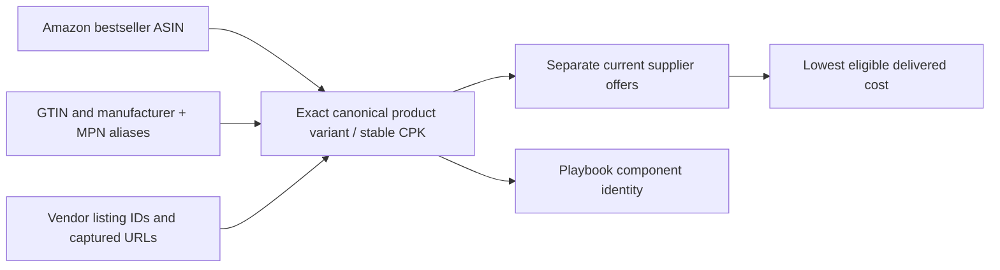

# CPK creation, lookup and assignment: recommended repair

26 October 2026. This is a source-backed diagnosis and proposed implementation design. It does not claim that the resolver, data repair or provider integrations below have been implemented. No production changes, account creation, paid lookup calls or subscriptions were performed for this research.

## Decision

Keep CPK as FlipFlop's stable internal identifier for one exact purchasable component variant. Attach evidenced GTINs, manufacturer part numbers, marketplace IDs and listing IDs to that product. Stop treating the hash of a free-form product name as authoritative identity.

Use one ordered resolver for ingestion, catalogue reconciliation and Playbook supplier selection. Exact identifiers should resolve most well-described retail components without an LLM. Use local Qwen for missing-field extraction and ambiguous candidate ranking, followed by deterministic variant checks. Do not add a new external matching platform or a custom-trained model for this repair.

Google documents GTIN, manufacturer part number and brand as the identifiers shared by retailers selling the same product. AWS documents ordered matching rules which record both a match ID and the rule responsible. These support the proposed approach, rather than a promise that title similarity alone establishes equivalence. [Google unique product identifiers](https://support.google.com/merchants/answer/160161?hl=en), [AWS rule-based matching](https://docs.aws.amazon.com/entityresolution/latest/userguide/creating-matching-workflow-rule-based.html).

## What is actually happening in FlipFlop

| Stage | Current implementation | Consequence |
|---|---|---|
| Capture contract | Backend `ExtractedListing` and observation model have `gtin`, `mpn`, `model_number`. Extension `ExtractedListingSchema` lacks those fields; its API converter keeps ePID but drops the available GTIN/MPN/model number fields. | Strong identifiers do not travel reliably through the source-to-backend contract. |
| Observation persistence | `record_observation` writes those fields when supplied. A read-only profile of the latest observation per source/listing over 14 days found 13,502 records across six retailer sources, with zero populated GTIN/MPN/model-number values. | This is a real extraction gap, rather than merely absent database columns. The denominator includes all recent listings in these six sources, not only the top ninety. |
| New-listing assignment | `assign_cpk_and_accumulate_price` receives listing ID, title, category, condition, prices and source URL. It does not receive GTIN, MPN or model number. | Even a correctly populated identifier cannot currently drive this assignment function. |
| Existing-listing lookup | Existing valid-looking CPK, then same-ASIN reuse, then longest model alias, then deterministic title parser, then local LLM extraction. | An old generic alias can win before a more precise fresh extraction. |
| Existing-identity validation | `_valid_existing_cpk` checks broad completeness/accessory/bundle rules, without fully validating stored brand/capacity/speed/kit against the current observation. | A reproduced 32GB/3200 title accepts saved 8GB/3600 metadata. |
| Repeat scan | The duplicate path in `_submit_scan_body` reuses any existing CPK and refreshes its price contribution without calling the assignment validator. | A bad identity can keep receiving fresh prices indefinitely. |
| Key creation | The deterministic and LLM paths hash category/brand/model. Model wording varies; `canonical_variant_model` adds only limited attributes, and is not a common resolver for all writers. | Equivalent products split, while underspecified models merge different variants. |
| Other assignment writers | `catalogue_cpk.reconcile_active_catalogue_cpks` has a different validation/reuse sequence. `playbook_service._catalogue_candidates` can also upsert CPK rows. | Catalogue, bestseller observations and supplier observations can disagree about the same product. |
| Price lookup | Supplier matching indexes existing keys and normalized metadata; missing exact MPN/GTIN joins and missing source URLs lose offers. | Repairing ingestion alone still requires repairing existing data and consumers. |

Relevant source locations:

- `flipflop-api/app/gem_radar/cpk_pipeline.py`: `_lookup_unique_catalog_alias`, `_valid_existing_cpk`, `assign_cpk_and_accumulate_price`.
- `flipflop-api/app/gem_radar/cpk_extractor.py`: `canonical_variant_model`, hash creation and LLM response validation.
- `flipflop-api/app/api/gem_radar.py`: repeat-listing branch around line 3138 and assignment call around line 3199.
- `flipflop-api/app/gem_radar/observations.py`: identifier persistence around lines 330–332 and listing/title deduplication.
- `FlipFlopXtension/src/lib/types.ts`, `src/content/ebay-api-extractor.ts`, vendor DOM extractors and submission serialization.
- `flipflop-api/app/services/catalogue_cpk.py` and `app/services/playbook_service.py`: additional identity writers.

The existing `products` model represents FlipFlop's own saleable stock/build products; `procurement_products` represents packaging/consumables. Neither is an existing exact component identity registry to repurpose silently.

## Recommended identification hierarchy

Apply contradiction checks at every level. One strong-looking but conflicting source value should not silently override another established identity.

| Order | Evidence | Automatic action |
|---:|---|---|
| 0 | Existing verified `(source, source listing ID)` mapping; identity-bearing evidence unchanged and resolver version current | Reuse the product CPK. Refresh price/stock independently. A title wording change alone need not trigger a model call; new conflicting identifiers or variant fields must trigger re-evaluation. |
| 1 | Validated GTIN/EAN/UPC for the same trade unit, with consistent manufacturer/category/pack evidence | Look up the existing product and attach the offer. Validate digit length and checksum; retain source evidence. A checksum proves number structure, not seller correctness. |
| 2 | Canonical manufacturer/brand + exact manufacturer part number | Resolve to that variant, provided package/variant evidence does not contradict it. Record the identifier even when the current title omits the model family. |
| 3 | Previously verified child ASIN, ePID or other source-local product alias | Resolve through its namespace and established product mapping. A vendor SKU identifies a vendor offer; a parent/group ID does not identify the exact purchasable variant. |
| 4 | Complete normalized category-specific variant signature | Match exactly when sufficient identity attributes are present and no ambiguity remains. Missing values are unknown, never wildcards that merge conflicting products. |
| 5 | Similar title, token match, image resemblance, embedding score or LLM suggestion | Retrieve and rank candidates; automatically fetch targeted product details to fill the missing evidence. These signals alone do not merge products or pool their prices. |

This is a practical waterfall, not a rule that a lower-priority signal must be ignored when it contradicts a higher-priority one. For example, an apparent identical GTIN paired with incompatible DDR4/DDR5 descriptions creates a conflict/enrichment task; it does not authorize either a false merge or a new duplicate product without investigation.

### Normalization rules

- **GTIN:** accept supported digit-string formats and validate check digits. Preserve raw value/format and compare a canonical internal fourteen-digit representation. UPC `740617344790` and EAN `0740617344790` can normalize to `00740617344790`. Do not coerce to an integer or collapse distinct packaging-level GTINs. Internal equality normalization is separate from how a source/feed expects GTINs to be rendered. [GS1 uniqueness and leading zeroes](https://support.gs1.org/support/solutions/articles/43000734386-are-all-gtins-unique-numbers-), [GS1 tools/check digits](https://www.gs1.dk/en/resources/tools).
- **Brand:** maintain an explicit small alias map for proven variants such as `be quiet!` and `be-quiet`. A brand typo produced by a model is a candidate correction, not a new manufacturer. GPU chip maker and board manufacturer are separate fields.
- **MPN:** preserve the raw manufacturer code. Normalize case/format only with manufacturer-specific rules. Never strip distinguishing suffixes, replace lookalike characters, or treat any merchant SKU as an MPN. `SNV3S/1000G` and `SNV3SM3/1T0` must remain different.
- **Numeric specifications:** use typed values and explicit units. Preserve kit capacity and module capacity separately. Do not confuse 2TB with 2GB, 3200MT/s with 3200MB/s, or a RAM timing with capacity. Existing 1000-versus-1024 capacity representations require a consistent unit policy.
- **Model names:** normalize presentation, then resolve against the category's known manufacturer/model vocabulary. Preserve CPU/GPU suffixes and model revisions. A model family is useful for discovery and substitutions, but is not automatically an exact trade variant.

### Minimum variant distinctions

| Category | Attributes that must remain distinguishable when present |
|---|---|
| CPU | Exact CPU model/suffix; retail boxed versus tray/bundle package and included cooler where these change the purchasable unit. |
| GPU | Board manufacturer and exact board SKU, GPU model/suffix, VRAM, OC/version and relevant form-factor variant. RTX family alone is insufficient. |
| Motherboard | Manufacturer, full board model/revision, Wi-Fi/non-Wi-Fi, DDR variant. Chipset alone is insufficient. |
| RAM | Manufacturer/family, DDR generation, total kit capacity, module count/module capacity, speed, latency/timing variant, ECC/registered state, relevant colour/RGB/profile variant. |
| SSD | Manufacturer/family/MPN, capacity, interface, 2230/2280/other form factor, heatsink/package variant. |
| PSU | Manufacturer, exact model/wattage/generation, modular/version and regional/package variants. |
| Cooler | Manufacturer/model/generation, radiator size/fan package, socket-specific variant and relevant colour. |
| Case | Manufacturer/model/generation, size, colour, panel and included-fan/PSU bundle variant. |

Condition, stock, price, VAT, delivery and seller belong to the **offer**. A used and new example can refer to the same exact product variant while remaining separate pricing cohorts. A functionally suitable alternative belongs to another product CPK; it can be a build substitution without pretending to be the same product.

## A concrete example

Kingston's own datasheet distinguishes NV3 `SNV3S/1000G` (2280) from `SNV3SM3/1T0` (2230). The first code appears with EAN `0740617344790` on the inspected UK retailer page. That evidence can unify these differently worded titles:

- `Kingston NV3 NVMe PCIe 4.0 Internal SSD 1TB M.2 2280-SNV3S/1000G`
- `Kingston NV3 1TB PCI-e 4.0 NVMe M.2 Solid State Drive (SNV3S/1000G)`
- `1TB Kingston NV3 PCIe 4.0 NVMe M.2 SSD`, **after** its detail page confirms the same MPN or GTIN.

The 2230 NV3 stays separate even though it shares brand, family and capacity. [Kingston datasheet](https://www.kingston.com/datasheets/SNV3S_en.pdf), [Overclockers exact MPN/EAN](https://www.overclockers.co.uk/kingston-nv3-1tb-pci-e-4.0-nvme-m.2-solid-state-drive-snv3s-1000g/STO-KNG-02942.html).

## Global data and lookup services

| Source | Useful role | Recommendation |
|---|---|---|
| Manufacturer product pages/datasheets and retailer Product JSON-LD | Extract explicit GTIN, manufacturer, MPN and exact variant facts already exposed by our source pages. Schema.org defines product identifiers and product-group/variant relationships. | Implement first. This addresses the empty fields in our own pipeline without a subscription. [Product schema](https://schema.org/Product), [ProductGroup](https://schema.org/ProductGroup). |
| Open Icecat | Registered product-content service with GTIN or brand+product-code lookups; particularly relevant to IT/electronics. Open coverage is limited; Full is paid. | Best first external coverage pilot against the ninety products. Measure exact variant coverage before buying anything. It enriches identity/specifications; it does not establish current retailer stock. Account/content licence terms must be checked, including any AI/embedding use. [JSON manual](https://iceclog.com/manual-for-icecat-json-product-requests/), [coverage](https://icecat.com/structured-data-content-users/), [posted licence](https://iceclog.com/content-license-icecat/). |
| Verified by GS1 | Validate barcode licensing company and available basic product information. Public lookups have a 30/day limit; API/premium access is arranged through GS1. | Target disputed identifiers; do not assume a free unlimited bulk API or complete hardware specifications. [GS1 service/access](https://support.gs1.org/support/solutions/articles/43000734077-what-is-verified-by-gs1-). |
| Amazon Catalog Items and eBay Catalog/Browse | Marketplace identifiers and relationships through authorized APIs. | Optional reuse of existing entitlements. These are scoped platform catalogs, not universal product identity authorities or substitutes for licensing/current-offer evidence. See the working official links and access requirements in the companion research. |
| EAN-Search / Barcode Lookup | Paid barcode/product lookup services. | Consider only if a measured pilot improves the unresolved sample enough to justify cost and permitted use. Do not assume authoritative variant coverage. [EAN-Search](https://www.ean-search.org/ean-database-api.html), [Barcode Lookup](https://www.barcodelookup.com/api). |
| GS1 GDSN | Supplier/trading-partner master-data exchange via certified data pools. | Defer unless distributor relationships justify the subscription/integration. [GS1 GDSN](https://www.gs1.org/services/gdsn). |
| Web Data Commons matching datasets | Research/evaluation examples of matching and nonmatching web offers. | Potential evaluation material, subject to dataset licence; not a current UK procurement catalogue. [WDC product corpus](https://www.webdatacommons.org/largescaleproductcorpus/). |

I found useful standards and enrichment sources, but did not verify a comprehensive, free, authoritative global PC-component catalogue with live offers across all target UK retailers. Open Icecat is the most relevant first pilot from this research; actual free-account coverage remains untested. Buying a lookup API before fixing identifier extraction would leave the central defect intact.

## Smallest robust architecture change

Use the existing FastAPI/PostgreSQL/worker architecture. Add two small identity tables and extend the existing listing mapping rather than introducing a PIM service or another queue:

1. **Canonical component products:** stable CPK primary key, category, canonical manufacturer/model, typed variant attributes, identity status and resolver version. Good existing CPKs may be retained as opaque IDs. New IDs should be assigned once; names and derived fingerprints may change without renaming the product.
2. **External identifiers:** identifier type, namespace, raw/normalized value, product CPK, source URL/time, verification basis and status. Enforce uniqueness for accepted identity claims within their proper namespace; conflicting claims enter a recorded conflict state. A product may have multiple evidenced identifiers. Do not assume every different GTIN proves a different physical model, or every repeated MPN proves an identical package; preserve trade-unit/pack evidence.
3. **Existing `gem_radar_listing_cpk`:** keep its role as the source-offer-to-product mapping; add match rule, identity-evidence fingerprint, resolver version and assignment status. Namespace source IDs explicitly. Reuse an existing event/audit seam for decision evidence if suitable; avoid another parallel unobserved writer.

One resolver interface receives the entire structured observation, including all captured identifiers and source facts. It returns matched/new/unresolved/conflict, the chosen CPK or candidates, the rule used, contradiction details and evidence references. The persistence wrapper handles indexed lookup, uniqueness/concurrent ingestion and idempotent assignment. All current CPK writers must call this interface.

Cache verified identities. Do not run the LLM on every scan. A new resolver version or changed identity-bearing evidence schedules re-evaluation; a price-only update refreshes the offer. Targeted enrichment should run asynchronously after durable ingestion. Missing fields should generate focused source work automatically rather than an ever-growing routine approval queue.

## Repair sequence

1. **Complete the input contract.** Add optional GTIN/MPN/model/brand/variant fields to extension extractors and schema; preserve them through serialization and backend ingestion. Parse JSON-LD and product specification tables from exact product pages. Keep raw identifiers and quoted source fields. Begin with the ninety products and all eligible top-100 cases, plus already captured candidate offers.
2. **Implement and verify the single resolver.** Existing source mapping, validated GTIN, manufacturer+MPN, verified marketplace aliases, exact variant signature, then candidate/enrichment. Remove generic alias acceptance as final identity proof. Pass identifiers into assignment and replace the repeat-scan bypass with evidence/version-aware reuse.
3. **Shadow-run before rewriting.** Produce old/new assignment diffs for the chosen Amazon anchors and candidate vendor offers. Label known positive/negative pairs. Count correct recovered links and prevented false merges; a larger vendor count alone is not success. Keep good current product references stable.
4. **Apply a reversible backfill in DEV.** Save the old mapping and decision evidence. Merge genuinely duplicate identities. Split contaminated CPK buckets at the individual source-listing level. A collided old CPK cannot be globally redirected to one new key; its listings need separate assignments. Do not bulk-hash every old row again or rely on the same faulty cached aliases.
5. **Recompute affected derived data.** Update current listing mappings/scored joins, bestseller/catalogue identities, vendor-offer links and market aggregates. Re-evaluate sold observations only when their own identity can be established. Keep historical orders and approved quote snapshots intact; generate new proposals for affected current builds.
6. **Finish end-to-end supplier selection.** Preserve exact captured product URLs, use all accepted identity aliases, and select the cheapest eligible available new offer with captured postage, saved vendor default, then £0 inbound fallback. Identity, source availability and build compatibility are separate checks. Record which vendors are linked, unresolved, unavailable or not yet searched.

## Acceptance examples

- Identical Kingston `SNV3S/1000G` titles from Amazon and Overclockers resolve to one product; the 2230 `SNV3SM3/1T0` does not.
- Correct UPC/EAN zero-format variants resolve together after valid checksum/identity checks; a case-pack GTIN does not silently become a single-unit price.
- Samsung 990 PRO 2TB descriptions resolve together when the exact MPN/GTIN confirms the same variant; 1TB/4TB and different heatsink SKUs remain distinct.
- Corsair LPX versus RGB PRO, DDR4 versus DDR5, 2×16GB versus 4×8GB and 3200 versus 3600 cannot collide through a family alias.
- Existing 8GB/3600 metadata attached to a 32GB/3200 title is invalidated and repaired instead of refreshed indefinitely.
- A parent ASIN/family identifier never pools child-variant prices. An ASIN whose structured identifiers conflict triggers re-evaluation.
- Concurrent ingestion of the same source offer or validated identifier creates one accepted assignment; retrying a submission is idempotent.
- New enrichment does not rewrite historical paid-order specifications or approved quote snapshots.
- The three earlier missed-link reproductions are rerun against actual ingestion/assignment/lookup seams; URL preservation and cheapest eligible offer selection are checked with the repaired identities.

## Evidence and remaining uncertainty

The code-path and database diagnosis is verified against this checkout. [Identifier field coverage](product-identifier-field-coverage.json), [earlier real failure reproductions](vendor-link-reproduction.json), and [detailed supplier-link investigation](vendor-link-deep-dive.md) are saved alongside this design.

The [companion external research](product-identity-external-research.md) records primary sources, API prerequisites, advertised provider plans, manufacturer examples and licensing considerations. No authenticated provider coverage benchmark, new resolver implementation or identity backfill was performed in this research task. Those are the implementation steps above.
