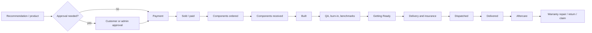

# Order and build lifecycle

**Status:** Current lifecycle design  
**Last reviewed:** 2026-09-29  
**Customer-safe:** No; customer-facing wording lives in the support knowledge base

## Identity and portal ownership

Registration creates an empty customer portal. A customer may own multiple orders and multiple personalized build portals over time.

Each physical build has one build portal. A customer portal links to all build portals owned by that customer.

Marketplace sale notifications never create or attach customer accounts based on a buyer email. The monitor may retain a parsed buyer email on the sold build for the printed claim flow to verify against; account ownership is established only by sign-in or the scoped one-time claim process.

- Ready-to-Ship: the build portal and orchestration Build row exist before sale so benchmarks, photos, and physical component data can be recorded at `Built`. At `Sold`, that same job and Build row are linked to the customer/order; the row's physical component spec is preserved while the customer/order link is added.
- Curated-for-you and Made-by-you: payment and `Sold` occur before the unit is built. The build portal is created/linked at sale, then gains specification, benchmarks, photos, and documents as later stages complete.
- Guest/indirect purchase: the build portal exists without silently creating an authenticated account. For direct guest orders, physical dispatch automatically issues a revocable high-entropy one-time claim link to the verified order email with tracking details; the one-time secret is carried in the URL fragment and removed from browser history before redemption; the buyer explicitly presses the portal button to avoid automatic consumption by email scanners. If email delivery fails, the admin receives a failed-send result and can reissue the link or print the private QR leaflet from Dispatch Centre. New claim grants default to 400 days, matching the 400-day build-scoped session exchanged on redemption so a buyer can claim portal access across the 12-month warranty window even if they redeem late. Revoking the underlying claim grant invalidates the session immediately. It can read the portal and submit support/warranty cases only; it cannot edit account, order, software, or delivery data. For eBay, Vinted, and other indirect channels, the claim is bound to the sold build and delivered only through the private printed QR leaflet inside the parcel. A buyer email is optional for this grant; when supplied it must match the recorded marketplace email. No claim email or raw bearer URL is sent to or displayed by Dispatch Centre. Surname plus order number alone is insufficient authentication.

Billing and delivery addresses are stored as immutable order snapshots. The customer may choose “billing same as delivery.” Made-to-order checkout holds the addresses in a private, expiring payment-intent snapshot until payment is confirmed; the browser confirmation and Stripe webhook recovery both transfer them to the order. The linked build shell and Getting Ready record are created at sale, then enriched with the physical build and measured evidence as work progresses. Structured address and contact fields stay on the order and are removed recursively from the shell spec, while technical component specification fields are retained.

## Canonical lifecycle

The operational state model may use more detailed internal states, but customer copy maps them to understandable milestones.

## Product-specific sequencing

### Ready-to-Ship

`Planned → Components/stock secured → Built → QA → Listed → Sold → Getting Ready personalization → Delivery booked → Dispatched → Delivered → Aftercare`

Performance testing may happen at `Built`, before the customer exists. At `Sold`, customer/order details are attached; at `Dispatched`, courier and tracking data are attached.

### Curated-for-you and Made-by-you

`Recommended/configured → Approved → Paid/Sold → Components ordered → Components received → Built → QA/benchmarks → Getting Ready → Delivery booked → Dispatched → Delivered → Aftercare`

The customer may edit allowed software choices until `Components ordered`. Benchmark documents cannot be completed before `Built` and QA.

### Flip Refresh

`Remote assessment → Provisional scope/quote → Customer approval → Payment → Customer ships PC → Received (service clock starts) → Intake validation → Discrepancy approval if needed → Components ordered → Work → QA/benchmarks → Getting Ready → Return delivery → Delivered → Aftercare`

## Gates and customer changes

- Approval gate: required for the selected build, material substitution, discrepancy, or reprice.
- Payment gate: procurement does not begin until payment is safe to use.
- Before `Components ordered`: direct made-to-order customers can cancel for an idempotent full refund; sourcing pauses before the payment provider is contacted. Software edits stop while refund reconciliation is pending and the order-linked Build and Getting Ready job become cancelled after a successful refund. Build changes become a request and pause sourcing until reviewed/repriced. Ready-to-Ship stock has already passed this gate before listing, and indirect sales must use the channel's cancellation process or contact support.
- At and after `Components ordered`: self-service changes and cancellation close. Support handles requests under the agreed contract and statutory rights.
- Implementation boundary: the generic admin component-edit endpoint rejects direct edits once a ManualBuild is sold. The authenticated order API persists pre-sourcing change requests and pauses status transitions. Customers can submit/withdraw in their portal; administrators can quote or decline in order detail. The portal displays a quote and supports declining it. Quote acceptance is rejected by the API until the price-difference settlement and paid-order application steps are implemented. No quote changes the paid order or resumes sourcing. Support must coordinate completion manually and must not represent a quote as an applied substitution.
- Dispatch gate: finish non-photo Getting Ready work, explicitly book and pay for the signed-for courier, upload working-build media plus the contents-before-packing and sealed-parcel photos, explicitly register insurance, then confirm physical handover. Courier booking, insurance purchase, and handover are separate actions; nothing dispatches automatically.

## Delivery and aftercare events

- `Dispatched`: send account customers a shipment update and direct guest customers a one-time portal claim with courier and tracking details; show courier, tracking ID, current status, and live map/link where the courier offers one. Failed direct-storefront dispatch messages remain retryable with backoff and alert an administrator after eight failed attempts. Indirect-channel customers use the printed claim leaflet and the marketplace's own delivery updates.
- Normalised courier events are append-only and idempotent by provider event ID. Material events may email the customer; every event remains visible in the private portal timeline. Live-map URLs are displayed only when supplied by the courier over HTTPS.
- Courier events update the build portal and generate useful email updates without duplicating noisy carrier messages.
- Account and claimed-guest portals display submitted software choices with their indicative setup-time estimate. Guest access remains read-only apart from support-case submission.
- `Delivered`: record actual delivery date. This starts the 12-month FlipFlop commercial warranty and schedules reserve expiry (a 29 February start expires on 28 February the following year), subject to open claims. For Parcel2Go, use the valid, non-future carrier stage time; malformed or future times fall back to webhook receipt time.
- The manual operator shipment-event action rejects future delivery occurrence times rather than moving the warranty clock into the future. Parcel2Go's verified webhook adapter retains its receipt-time fallback for malformed/future provider timestamps.
- An administrator cannot mark an order `completed` to synthesize delivery. A confirmed carrier delivery or an explicit operator delivery event with its occurrence time must be recorded first; the warranty and reserve clock use that recorded time.
- An order-linked physical build uses the order as its single warranty-reserve owner. Shipment events for it must be recorded against the order ID; build-scoped delivery events are reserved for marketplace/manual sales that do not have a linked order.
- When an order delivery event belongs to a linked physical build, the earliest confirmed occurrence time updates the ManualBuild delivery timestamp, warranty start timestamp, and delivered dispatch state, including when events arrive out of order. An administrator completing an order with an already-recorded delivery timestamp also reconciles those fields. The warranty reserve remains order-owned; no second build-owned reserve is created.
- Returns, delivery-insurance claims, and warranty repairs become linked cases with evidence, messages, costs, and outcomes.
- Warranty cases use a customer-visible repair journey: received, reviewing, approved, awaiting customer return, return in transit, received for inspection, repair in progress, waiting for parts, replacement arranged/dispatched, resolved, rejected, or closed. Admin claim updates synchronize the linked portal case status, and both entry points keep the reserve claim state aligned. Admins can attach a Parcel2Go `OrderLineId` and HTTPS tracking link for a customer-return or replacement leg at its matching in-transit stage; the reference is bound to that exact shipment. Authenticated, deduplicated Parcel2Go events automatically update only the matching leg's portal timeline. A delivered customer return in `return_in_transit` advances to received for inspection without restarting the original build warranty. Direct storefront customers receive a transactional email for Parcel2Go return/replacement delivery; marketplace/manual-build cases keep events portal-visible and customer communications on the original channel. Other carriers remain link-only until an adapter is implemented.
- Delivery creates a warranty-reserve ledger entry using the sale's configured percentage (5% default) and the recorded delivery date.
- Warranty cases allocate approved costs to that reserve. Any open or in-progress claim blocks expiry eligibility.
- A signed-in customer or verified guest portal holder can open a support or warranty case; the case is linked to its order/build, warranty cases link to the reserve, and a durable admin alert is committed atomically with the case. New warranty cases acquire the owning order/build lock before insertion, and explicit reserve release uses the same owner-then-reserve order. This serializes release with a claim whose case row has been flushed but whose reserve linkage is still in progress. Owners and scoped guest holders can add private, checksummed JPEG/PNG/WebP/PDF evidence to their own cases; the admin queue can download that evidence. If a warranty case arrives before the delivery record/reserve exists, delivery-time reserve creation attaches it; an already-resolved support case remains resolved.
- At twelve calendar months, a scheduled review locks the owning order/build before the reserve, rechecks expiry and claim state, then marks a claim-free reserve eligible and alerts the administrator once. Concurrent runs skip locked records. It does not move money.
- Release records the remaining eligible amount, administrator, timestamp, and note only after explicit admin confirmation. Statutory-rights cases remain supportable after the commercial warranty period and are not decided by this accounting status.
